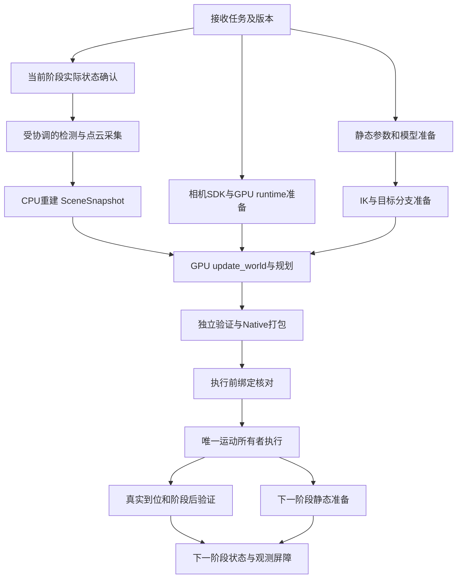

# 全系统准备、观测与并行架构研究

日期为2026-11-13。本轮交付为现状审计和架构设计。现场运动、生产调度器、任务参数及自启动配置在本轮均未改动。新Turbo双线程脚本已作为候选上传，尚未执行本轮新增流水线实验。

## 1. 结论和范围

全系统收益来自准备任务的依赖管理、共享服务常驻、观测事务和运动所有权的统一。线程数量须由资源和输入有效期决定。

现场盘点覆盖12个catalog别名、11份参数文件，另外检查已交付CenterRestore ROS入口和Turbo候选。对153个有效Python模块建立1179个函数索引，深入审阅Demo执行族、任务调度、观测事务、场景、planner supervisor、SDK读租约及Native边界。索引保存在 `release/ros1-speed-20261113/planning-study/system-call-index.json`，别名覆盖表在同目录 `demo-coverage.json`。

该覆盖表示代码和配置盘点，不能证明所有动态分支均已运行。反射、注入provider、SDK二进制、相机内部算法以及ROS Node.js客户程序仍需独立接口测试。未宣称逐行审计全部1179个函数或所有第三方实现。原始现场快照已保存至Mac私有归档。

## 2. 当前实际调用族

|Demo族|现场入口和共用链路|并行设计关注点|
|---|---|---|
|demo-0-return-center|run_return_center_demo.py → SceneAwareMotion → LocalScene → cuRobo → Native|启动准备、fresh scan、终点IK分支、执行/到位|
|ROS Demo01|CenterRestoreConsole → center_restore.runner.run → 当前→center→保存姿态|连续两段；已在center时只做实际到位确认；下一段actual start重绑定|
|demo-1-main-grasphold|run_first_pick_demo.py → first_pick package → contact/100mm lift|结束持物；维持100mm历史语义|
|demo-2-main-graspplace|run_grasp_place_roundtrip.py → RoundtripJob → Live|抓取230mm、底盘转场、放置、释放和返程；存在checkpoint/reconcile机制|
|demo-2-branch-grasprptspdup|run_pick_reset_demo.py → run_pick_reset_timing.py|固定底盘；pregrasp/contact/lift/lower/retreat/center；已有Native分段预打包|
|demo-3-branch-sift-graspreset|run_sift_pick_reset_demo.py → run_task_pick_reset_timing.py|任务参数及ID6；已有并行scene/readback与下一段Native准备|
|筛网独立HOLD|prepare_sift_lift_hold.py → run_sift_lift_hold.py|保持结束；采用任务级读回时序，不能套用旧料盘时间窗|
|demo-4-main-siftgrasp-dmpplace|run_sift_dmp_roundtrip.py.stage_pick/transit/place/center|抓取HOLD后底盘转场，再扫描放置；含独立嵌入式place实现|
|demo-5-main-dmpplace|run_dmp_place_demo.py.stage_place/stage_center|预放置、MoveL接触、松爪、x−退出、center|
|demo-6-liaopan-placetoDMP|同run_dmp_place_demo.py，通过demo-id和参数区分|当前V7实参D20，catalog部分旧标题仍写D10|
|demo-2-liaopan-placeto-hongganxiang|同放置执行器，ID3+泊位注册表+水平流形|泊位偏置、可见性、槽口、下降及退出几何|
|demo-1-liaopan-placeto-cheng|同放置执行器，ID9|当前现场新增；不能由11月12日源码快照推断有效参数|
|demo-7-shaiwang-placeto-cheng|同放置执行器，ID8|当前V3；近期SDK读异常、奇异保护及center IK经验需保留|
|Turbo Preview|独立run_preview.py及候选run_pipeline_preview.py|冻结两段GPU准备实验，没有物理执行发布|

多个alias可复用同一执行器，也存在相同业务含义的不同历史runner。适配单位应是带参数revision的执行族。catalog类型/标题与当前参数、验收记录可能不一致，启动绑定以实际参数和源SHA为准。

## 3. 已有并行能力和具体缺口

|现状|代码证据|影响|
|---|---|---|
|已有4线程prepare池|task_runtime.py SchemeRunner.run，prepare_after/depends_on|可复用调度结构，但prepare内容需分类|
|资源锁主要在execute获取|skills/runtime.py SkillRuntime.prepare/execute；skills/locks.py|prepare可能已调用motion.plan/contact.plan，不能视为无资源副作用|
|Skill锁是进程内threading.Lock|ResourceLockManager|不能自动覆盖独立脚本、ROS子进程及Native|
|Scheme上下文复用初始binding|SchemeRunner.prepare与execute传入binding|不能以相同字典比较证明跨底盘移动的真实现场状态仍有效|
|观测缓存按profile索引|skills/real_provider.py _observation_call|缓存缺少task/epoch/base/tool/attachment维度，跨任务或移动后存在复用风险；需现场注入bundle路径核对后修正|
|5700和5000已有并行事务|observation_transaction_v2.py|仅关节稳定与时间偏差检查不足以证明两次触发属于同一帧|
|原事务V1串行检测和场景|manipulation/observation_transaction.py|部分Golden仍走此链，不能只根据V2存在就认为已全局加速|
|已有后抓取并行验证|pick_reset_pipeline.py collect_during_scene|滚动采样直到scene完成，解决过期读数；属于可直接复用模式|
|已有连续底盘静止监测|StationaryBaseMonitor|可在其他准备期间积累窗口，避免每段固定等待；底盘移动须明确结束该监测段|
|SDK读取与Native共享右臂独占锁|motion/controller_read_lease.py|Servo执行时另开JAKA SDK读取可能失败；UI应消费sender发布的反馈|
|planner只保留一个CUDA runtime|persistent_planner_service.py runtime_key/PlannerSupervisor|FAST/QUALITY切换及构造配置变化会重建；进程常驻不等于runtime命中|
|AsyncEvidenceWriter已存在|skills/evidence.py|只适合可异步证据，派发标记和所引用的不可变包仍须先完成提交|

以上是扩展并行前需要解决的工程接入问题，尚未作为新生产拒绝条件部署。

## 4. 统一调度的核心合同

沿用canonical backend作为唯一任务所有者，TaskRuntime负责编排，ROS/ART/WebUI共同调用。现有Golden通过薄适配逐族接入。

每个stage显式声明以下字段，字段值由执行族定义并锁定版本。

- `depends_on` 指执行前必须实际完成的阶段。
- `prepare_after` 指允许开始准备的阶段。
- `prepare_kind` 为STATIC、OBSERVATION_BOUND或PREDICTED_STATE。
- `prepare_resources` 与 `execute_resources` 分别声明准备和执行占用。
- `input_revisions` 绑定任务参数、标定、工具、机器人模型、持物几何、底盘站位、观测epoch和实际起点。
- `expected_state` 只表示预计到位状态，不能替代实际到位。
- `rebind_policy` 指定预计状态与实际状态的比较方法，沿用已验收容差。
- `invalidate_on` 指定base/arm/tool/gripper/attachment/目标/场景变化的影响范围。
- `cancel_policy`、`deadline`、`evidence_barrier` 和明确结果类型。

准备产物依次可处于TEMPLATE、SPECULATIVE、BOUND、VALIDATED、CONSUMED，另有INVALIDATED/CANCELLED。只有当前任务绑定且通过既有执行前检查的产物才进入执行。SPECULATIVE被舍弃是正常调度结果，应有原因和耗时，不应冒充机器人FAULT。

避免把整个任务起点绑定字典传给后续所有阶段。每个阶段到达屏障后读取本阶段需要的实际版本，再决定复用、重绑定或重新准备。

## 5. 资源所有权

|资源|推荐所有者|允许的并行|
|---|---|---|
|右/左JAKA执行会话|每臂单独执行actor|同臂SDK命令串行；Native发布反馈供UI复用；左右臂并发须另做互碰与锁验收|
|夹爪串口|每夹爪单独actor|命令与回读串行；可与CPU/GPU独立工作重叠|
|AMR动作|单一base actor|导航命令串行；计算、参数加载可重叠|
|Pixel Pro拍摄|按camera_id单一acquisition owner|触发拍摄需仲裁；帧下载/解码可以流水化，须保留frame_id|
|Epic项目配置与5700会话|按endpoint/project配置所有者|space/object/camera切换和事务不得串台|
|GPU planner|有界常驻runtime管理器|默认一个请求占GPU；优先保持FAST热runtime；其他profile在显式策略下使用|
|CPU场景重建|小型有界进程池|处理不可变帧；避免Open3D/BLAS各自开满16线程争抢Servo/SDK|
|证据|独立有界writer|异步大文件，关键派发与绑定记录同步提交|

准备阶段也需要资源预约。固定顺序申请资源，不能占着相机锁等待GPU，也不能在CPU线程池里等同一池的后续任务。资源等待、计算耗时和设备等待分别计时。

当前只有右臂Native读锁的实现证据，不能据此宣布双臂读写已全局协调。ROS新Action、旧脚本和Native均须接到同一所有权协议。

## 6. 什么可以预加载和热启动

|对象|何时准备|何时失效|
|---|---|---|
|参数/schema/工位路径模板|服务启动、任务接收|文件SHA/任务revision变化|
|URDF、mesh、球模型、SE3固定变换|服务启动，按几何/工具revision缓存|模型、tool、安装或标定变化|
|Python、Torch、CUDA、优化器、graph buffer|服务启动或独立PrepareSystem|构造profile、球数量、容量、URDF、姿态代价结构变化|
|CUDA graph首次捕获|服务准备时以冻结样例触发一次|对应runtime重建；每请求不重复丢弃full solve|
|EpicEye SDK、连接与缓冲|常驻相机服务|设备断连/配置切换；恢复后显式状态核对|
|桌面/柜体已知几何模板|站位/资产准备|站位/物体或标定变化；安装固定与移动物体分开|
|Native格式、sender hash、配置验证|任务准备|二进制、速度/工具或格式变化|
|运动路径时间参数化|几何路径确定后|轨迹、速度/加速度/工具绑定变化|

不要把每次命令启动新的Python进程称为热启动。服务READY应暴露实际runtime key、cache命中、构造状态和预热状态。当前冻结实验热planner约1.2秒成立，首次冷请求约5.7秒，外层Python/Torch导入另计。

## 7. 扫描和检测的时机

|阶段|完整环境扫描|可提前的内容|必须等待的事件|
|---|---|---|---|
|任务尚未开始、环境可能有人摆放|可作预览/可见性判断；不直接绑定未来执行|连接、配置、静态模型和runtime准备|任务起点确认与目标摆放完成|
|GRASP站静止|一次pick ObservationEpoch，关联目标和点云|CPU/GPU加载可与拍照重叠|before/after实际状态、相机配置及帧关联|
|自由空间前往pregrasp|默认不把运动中的结构光帧作最终planning scene|contact/lift的任务模板、CPU验证、已有路径Native打包|实际pregrasp到位；接近段现有起点/目标校验|
|夹爪闭合、尚未抬升|需要规定窗口的真实夹爪回读|已规划lift的打包与审计可同时做|至少建立既有HOLD_CANDIDATE条件|
|受控抬升途中|运动模糊/自体遮挡帧不能默认作最终scene|后验证器、Place参数、runtime及证据准备|实际lift完成后持物验证|
|lift结束静止|后抓取验证scene或有合同的局部ROI观测|夹爪滚动回读与scene构建并行|两类证据均新鲜且确认实际抬升|
|持物往center|环境可复用需按已验收任务合同判断；新持物几何必须加入|转场命令模板、Place配置/SDK热加载|center实际到位和允许的持物转场状态|
|AMR转场途中|可辅助预览与可见性；不作为到站后的BODY执行scene|5700协议准备、Place IK模板、CPU/GPU静态准备|实际SETTLED、map/station/base revision|
|PLACE站停稳|fresh place ObservationEpoch|到站前已完成静态准备；扫描后CPU重建与GPU准备重叠|当前检测、点云、持物、工具和actual start绑定|
|进入dock/下降|沿已确认接触阶段合同；无需为每个微小下降反复完整扫描|松爪策略、退出路径与证据准备|实际到位、受控接触/下降的原验证|
|松爪后|真实夹爪release确认；ROI可作放置确认|退出段模板、下一任务静态准备|release确认后detach，随后退出接触区|
|退出后回center|自由空间环境判断按当前任务观测有效期和预期动作合同|可提前准备center语义目标|退出实际完成，fresh/有效scene和空手几何绑定|

扫描不能仅以“间隔多少秒”判断可复用。环境可见性、base/camera位姿、双方关节、持物、目标和标定revision均影响其用途。采集时的机器人状态用于该帧self-filter；不能拿现在关节去过滤之前帧，否则会留下或删错机器人点。

## 8. 5700与5000的并行边界

现有V2同时调用detect_resource和capture_pointcloud，而5700复合命令可能包含110触发拍照，5000也会trigger_frame。因此两个TCP端口不同不能证明采集硬件独立。

优先级方案为以下顺序。

1. 若官方接口允许同一frame_id/同一次采集的数据同时用于5700检测和XYZ，则一次触发，检测与点云解码/重建并行。
2. 若无法共享帧，按camera_id串行触发，允许上一帧下载/解码与后续独立CPU准备流水化；记录两个frame_id、实际采集时间和配置。
3. 只有证明Epic项目在配置和触发上互不干扰后，才启用独立双采集并行，并保留状态bracket和时间差要求。

现有V2不能因时间接近就自动标为同帧；官方帧关联能力、原始UI/SDK项目状态还需进一步核实。对结果对象、单位、左右臂坐标和TCP profile继续保留已有校验。

## 9. 两种计划提前量

静态prepare可以在前一段执行时直接做。完整几何规划属于有状态准备，只能作为SPECULATIVE；其起点是前一段预计终点，必须标明预测来源。

前一段到位后，比较actual start、base/scene、inactive arm、tool、attachment和任务参数。满足原有容差且观测合同仍有效时才重绑定；否则重新扫描或重新规划。任何修改后的轨迹都重新经过已有几何及动态检查，不能通过插接第一点修复起点偏差。

跨AMR移动提前生成的BODY具体执行轨迹默认是预测产物。到站后目标、场景和BODY-world关系必须更新。可以缓存IK seed或语义目标，不能把旧站位scene原样带到新站位。

当前每次机械臂运动会使LocalScene失效。若未来需要在同一任务中复用外部环境点云，必须把“采集时self-filter后的环境几何”与“当前双方/持物状态”分层，并定义EXPECTED_MOTION事件与有效期。该方案需要额外回归，不能只移除现有invalidate调用。已验收contact/lift package按其现有合同执行，不能强制插入新的全量扫描拖慢Golden。

## 10. 不能直接开启的物理并行

- 同臂两个运动命令或Native和SDK同时写控制器。
- 手臂动作未到位就依据预计状态更新目标绑定。
- 物体未夹持确认就底盘转场；尚未release确认就detach或返回。
- 运动中的结构光扫描直接替代静止绑定，除非验证了采集时序、运动补偿和robot self-filter。
- 为减少等待同时对同一Pixel Pro切项目、切space/object并触发两套采集。

“抬升达到5cm就底盘后退”和“底盘移动同时收臂”属于移动操作能力。需要以实际TCP进度事件触发，确认持物状态和整体持物/双臂/车体扫掠、同步body/map变换、SDK反馈所有者、故障联合停止。现有StationaryBaseMonitor会将此判为BASE_MOVED，因此必须实现明确的组合运动模式并单独commission，不能以另起线程绕过静止合同。本轮不新增此类物理并发。

## 11. GPU调度与FAST/QUALITY

优先一个热FAST请求占用GPU，将CPU和相机工作与它重叠。当前实验FAST50+Native独立验证完整热worker约1.25/1.29秒，QUALITY无warmup仍24.17/30.85秒。先改失败分类，避免模型/场景错误机械切QUALITY。

FAST100与FAST50的policy目前进入runtime key，切迭代也可能重建；有界fallback要先验证构造key与预算参数的分离。多runtime可按有限LRU缓存，但单GPU上是否保留第二个QUALITY runtime需依据显存和最坏延迟实验决定。

FAST+QUALITY竞速尚未证明收益，GPU满载时会争抢算力。若试验，按“到可验证且完成Native打包的结果”为胜出条件，计算路径执行成本，取消另一候选并确认其GPU工作停止；不能两个结果都下发。

## 12. 可复用流水线示例

TaskRuntime可以使用现有依赖图，但prepare拆成静态部分和绑定部分后再接入。每种prepare都通过统一资源预约，后台prepare出错只失效候选；当前运动是否停止由错误是否影响其已绑定合同决定。

## 13. 证据、取消、重启与观测UI

派发前同步提交request_id、轨迹/包hash、一次性派发标记和lease；原始云、大图、详细诊断走异步有界writer。不能先发动作再异步写唯一派发标记。writer背压应限制准备队列，不能静默丢证据。

Stop属于优先通道，不能排在长规划或证据队列后。取消CPU/GPU准备后释放其资源；已执行的动作须按原流程确认真实停止。重启后根据派发标记、控制器和进程状态恢复UNCERTAIN，不自动重放夹爪或轨迹。

UI/ROS状态同时显示current EXECUTING、next STATIC_PREPARING/SPECULATIVE/BOUND、资源BUSY/READY、scene age和actual/estimated时间。实时机械臂状态优先来自Native反馈；标明采样时间与来源，过期缓存不能显示为新鲜。

## 14. 分步实施和验收

1. 固化执行族、参数与调用索引，统一分项时钟、请求ID、源SHA、缓存命中和取消证据。修正文档标签与实际参数差异。
2. 在Turbo候选测量GPU准备与CPU场景重建的串行/并行，使用相同保存点云做重复实验，明确剔除冷启动顺序偏差。当前新增脚本尚未执行。
3. 上线独立非运动PrepareSystem，复用热SDK、planner及模型；增加prepare资源锁，打通跨脚本canonical所有权。一次任务只允许有界lookahead，避免无限未来任务把显存和CPU耗尽。
4. 在Demo01候选接入fresh场景的在线planning-only，比较每一项scan→scene→plan→package等待，再测相同起点的完整往返。
5. 逐族迁移pick-reset/HOLD，再迁移place和完整roundtrip。历史Golden继续保留调用入口与验收记录；新参数和新并行方式独立验收。
6. 最后研究移动底盘与手臂物理并发，及FAST/QUALITY竞速。

最低回归覆盖scene/base/tool/attachment中途变化、同相机竞争、Native时SDK读取、gripper读数过期、prepare失败不误伤当前段、任务抢占、取消/超时子进程清理、重启不重放、证据背压、左右臂共用空间和外部人工移动。性能必须测完整周期、p50/p95、失败率、无用prepare开销、冷启动频率与资源峰值，不能只给solver秒数。

每一轮先记录原实现和并行候选在相同数据/约束下的结果。准备重叠收益按时间区间交集计算，不能简单把各阶段耗时相加后当总周期。
