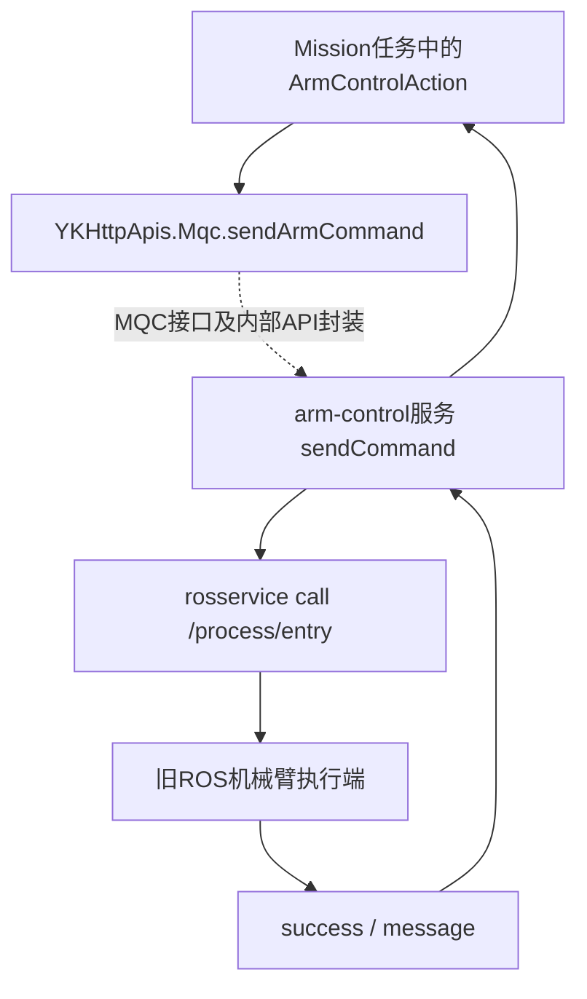
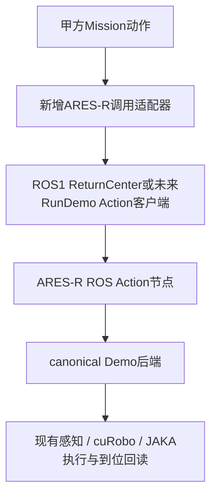

# 甲方nodeapp参考工程与ARES-R ROS封装说明

核查日期：2026-11-12。参考文件由甲方提供，原始位置为Mac的`/Users/andyee/Developer/xBBMG/nodeapp`；实际主体位于其下`nodeapp/node-amr/`。本说明仅保存结构分析和对接建议，不转载甲方源码、数据库、配置、压缩包或凭据，也不代表甲方已确认最终接口合同。

## 1. 这套工程是什么

这是一套以Node.js为主的移动机器人和实验设备任务系统，包含网页、HTTP业务接口、任务队列、设备通信和进程管理。`node`在这里首先指Node.js运行环境；它与ROS Node不是同一个概念。

它已经包含一个调用ROS1机械臂服务的适配程序，因此非常适合作为“甲方任务系统怎样触发机器人功能”的参考。它本身不是一套完整的ROS节点源码工程；不少模块以编译后的`.js`、`.d.ts`和`.map`形式提供，网页主要是打包产物。

外层`nodeapp/`还有重复的package.json和部分modules，不能仅凭同名目录认定哪份是实际部署版本。本轮重点核查的是内容较完整的`nodeapp/node-amr/`，未启动整个参考系统。

## 2. 目录速查

以下路径均相对参考主体`nodeapp/node-amr/`。

| 文件/目录 | 已读代码体现的职责 |
|---|---|
| `README.md` | 项目结构和模块启动说明 |
| `app.js` | Express主入口、HTTP代理、主程序启动/退出/重启 |
| `entry.js` | 按launch配置启动子进程，支持心跳和异常重启；加载auto-start脚本 |
| `launch/` | 子模块启动配置 |
| `modules/main-server/` | NestJS业务接口，包括任务等服务 |
| `modules/mission/` | 任务队列、动作注册、任务执行状态机和进度日志 |
| `modules/mission/mission/actions/` | ArmControl、RelativeMove、ApiCall等动作类 |
| `modules/auto-start/arm-control.js` | 注册机械臂调用服务，将请求转到ROS1 `/process/entry` |
| `modules/mqc/index.js` | TCP服务注册与调用转发，并提供HTTP桥接入口 |
| `modules/modbus/` | PLC、泵和设备状态接口 |
| `modules/grpc-proxy/` | gRPC相关代理模块；不据此推断其与ROS的直接关系 |
| `modules/view/`、`modules/webrtc/` | 网页与视频 |
| `resources/`、`cache/`、`logs/`、`lib/` | 配置资源、缓存、日志和随包运行环境 |

`jinyu_ws.zip`等压缩包也在目录中；本轮没有解包审计，不能据文件名宣称已取得所有ROS实现。

## 3. 关键：原有机械臂调用链



逐项核查结果：

1. `modules/mission/mission/actions/ArmControl.js`实现动作类，接收`parameters`和`missionId`，在`start()`中调用`YKHttpApis.Mqc.sendArmCommand`；等待调用返回后记录完成。debug模式会直接返回，不执行机械臂。
2. `modules/auto-start/arm-control.js`通过`MqcClient`注册名为`arm-control`的服务。其`sendCommand`接收`state`、`id`、`volume`，进行部分历史编号转换，然后通过命令行调用ROS服务`/process/entry`。
3. ROS返回内容被作为YAML解析；`success=false`抛错，成功时向上返回成功对象。
4. `modules/mqc/index.js`维护服务连接、服务名、请求uid和回调；其TCP使用自定义header长度和`-*-`分隔，HTTP入口形如`/_yk_mqc/*`。

第2和第4项构成服务桥的两端；`@yikun/apis`内部完整路由在本轮没有逐层验证。因此图中API封装到注册服务的中间路径作为接口级推断标注，不声称所有转发层都已实测。

旧ROS服务的`.srv`类型、`state`全部业务含义和实际执行端实现未在本轮确认。不能直接给ARES-R复用旧state编号。

## 4. 它怎样组织“功能块”

任务由`mission.actions[]`组成，每项指定动作类名称、参数，以及可选输入/输出绑定。`modules/mission/mission/actions/index.js`导出动作类；`machine/instance.js`按动作名称找类，创建实例并等待`start()`完成，再进入下一项。

```text
一个Mission
  → 动作1.start()
  → 等待动作1真正完成
  → 将返回值绑定到任务state
  → 动作2.start()
  → ……
```

外层`machine/index.js`管理任务状态、当前动作、进度及子进程事件。因此，一个“甲方动作节点”不等于一个“ROS进程”：一个动作类可以调用一个ROS Action，一个ROS节点也可以提供多个动作接口。

## 5. 对ARES-R应采用的对接方式

ARES-R已有ROS1包`ros1/ares_r_demo_bridge`，回center Action为`/ares_r/return_center`，由ROS节点调用现有canonical Demo后端。应继续保留这条单一执行链。



建议第一步只接回center：

- 甲方侧新增一个动作类，例如`AresReturnCenterAction`，不替换旧`ArmControlAction`。
- 适配器接收唯一`request_id`及现场确认，发送ROS Goal；保留ROS goal与ARES-R run_id的映射。
- 等待Action最终Result；只有`success=true`且到位已确认时，任务调度器才推进下一步。
- ROS Feedback映射到甲方任务进度；取消明确转发到Action取消，并确认后端停止。
- 失败返回阶段、错误码、实际TCP、位置/姿态误差、耗时和证据目录，不能仅返回“调用成功”。

甲方Node.js到ROS的具体客户端实现尚未选择；可以使用独立Python actionlib适配进程，由Node.js异步调用，或者使用双方约定的ROS通信桥。参考工程的`MqcClient`不能直接当成ROS Action客户端。

若短期优先接入，也可以让甲方动作适配器调用现有HTTP8775或原始TCP8790的Demo接口，再按run_id查询至完成。这能复用相同后端，但应明确称为网络接口对接，不冒称ROS Action已经接通。

## 6. ROS接口合同建议

| 层次 | 回center当前接口/建议 |
|---|---|
| ROS包 | `ares_r_demo_bridge` |
| ROS节点 | `ares_r_return_center` |
| Action名称 | `/ares_r/return_center` |
| Goal | 请求ID、现场观察确认、环境准备确认 |
| Feedback | 状态、阶段、run_id、累计耗时 |
| Result v0.2 | success、code、message、run_id、arm、pose_id、outcome、details_json |
| 姿态归属 | `right/center`；旧center兼容，不代表左臂目标 |
| 完成条件 | native完成/Servo退出，加连续新鲜实际状态到位确认 |
| 重发规则 | 网络超时不得自动创建新运动任务；先查原任务 |
| 后续统一接口 | 可新增`RunDemo` Action，通过demo_id和经校验的参数选择Demo |

参考工程的普通业务Action类与ROS Action接口名称相近，但不是同一技术对象。前者是JavaScript编排对象，后者是包含Goal/Feedback/Result/Cancel的ROS通信合同。

## 7. 应借鉴与不宜照搬

应借鉴：任务与动作分层、统一动作注册、参数传递、输入/输出绑定、进度事件、独立设备适配服务。

不宜直接照搬：

- `arm-control.js`的`execSync`会阻塞Node进程，而且使用字符串拼接命令。长运动应使用异步、结构化参数调用。
- 多个`rollback()`只有日志，并未实现真实恢复，不能把函数存在当成可安全回滚。
- `RelativeMoveAction`把Done、Abort、Aborted、Locked都作为等待结束条件，然后统一记录“完成”；新适配器必须区分成功与终止。
- 任务执行器通过结束子进程停止任务，并不能单独保证机器人停止。必须调用实际执行后端的停止/取消并确认。
- MQC调用层需补齐超时、断连、请求去重和结果归属；不能把HTTP已受理或ROS Goal已接收当作运动完成。
- 服务守护进程可自动重启，但不得因此自动重放运动Goal或续跑故障任务。

## 8. 已验证范围与下一步

已完成参考源码阅读，未运行甲方系统，未修改参考目录，未将甲方源码上传本仓库。ARES-R自身ROS回center已单独完成实机回归；甲方Mission经适配器到ARES-R ROS的端到端连接尚未实现、尚未验收。

最小下一步：双方确认一个“回center”动作参数/结果合同，新增甲方侧适配器，先用模拟后端验证完成/失败/取消，再接已验证的ARES-R ROS Action。不要先迁移全部底盘、双臂和抓放算法。

相关入口：

- [ARES-R ROS节点说明](../../ros1/ares_r_demo_bridge/README.md)
- [文档首页](../README.md)
- [常用指令](../CHEATSHEET_OFFLINE.md)
- [现场离线交接记录](../reports/2026-11-12_OFFLINE_HANDOFF.md)
