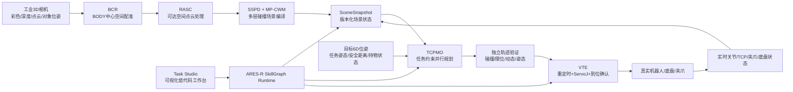
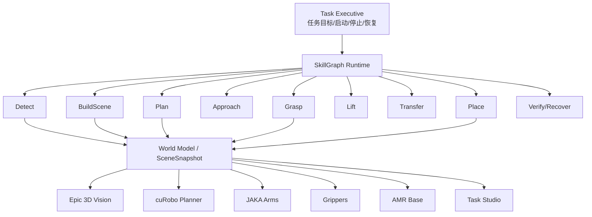
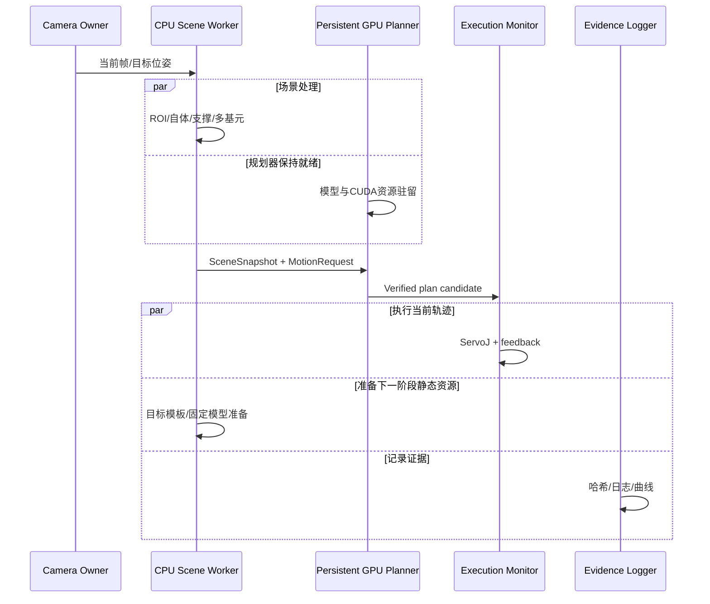

# 视觉—点云—cuRobo—ARES-R 预验收汇报技术参照文档

> 版本：2026-10-27  
> 用途：指导“视觉、机械臂规划控制与ARES-R框架”部分的预验收/阶段汇报PPT制作、素材补充和现场答辩。  
> 适用范围：北京工业大学团队负责的工业3D视觉、点云场景建模、cuRobo规划、JAKA执行、ARES-R任务框架及实机Demo。  
> 重要说明：本文中的英文缩写和算法名称大多为**项目汇报用技术模块名称建议**，用于统一表达，不等同于已经公开发表或注册的软件/算法名称。涉及实测数据时必须保留适用场景、冻结输入和验收边界。

---

## 0. 文档阅读标记

- **[V] 已验证（Verified）**：已有实机、冻结数据、日志或测试报告支持。
- **[I] 已实现（Implemented）**：代码链路已经存在，但未必完成充分实机重复验收。
- **[P] 规划/建议（Proposed）**：适合作为后续技术路线，不应写成已经完成。
- **[M] 待补素材（Material Needed）**：需要重新导出图、录制视频或统计数据。
- **[B] 边界条件（Boundary）**：正式汇报中必须主动限定，防止被追问时过度承诺。

---

# 1. 汇报要解决的核心问题

上一版PPT能够说明“系统能运行”，但还不足以回答以下三个关键问题：

1. **为什么这项工作有技术难度？**
2. **使用了工业相机和cuRobo以后，北工大团队究竟开发了什么，而不是简单调用API？**
3. **为什么这套系统能够从一个料盘Demo继续扩展到筛网、除尘收料等新对象和新专机？**

正式汇报的主线不应是“相机识别—机械臂运动—Demo成功”的流水账，而应提升为：

> **面向工业实验任务，构建从高精度三维观测到可执行运动的场景自适应技术体系：将现场点云转换成具有任务语义、几何保守性和实时性的碰撞场景，在多重工业约束下完成GPU并行轨迹优化，并通过ARES-R将感知、规划、验证、控制和恢复组织成可复用的任务能力。**

这句话对应三个真正的技术模块：

1. **高保真三维感知与场景几何编译**；
2. **基于cuRobo的任务约束并行运动优化与平滑执行**；
3. **ARES-R参数化技能执行与跨任务泛化框架**。

---

# 2. 推荐的总体技术命名体系

建议整套系统使用一个总名称，内部再用少量模块名支撑叙事。不要每页都发明一个缩写，正式PPT建议使用总名称 + 4～6个核心模块名。

## 2.1 总体系统名称

### **ARES-SAGE**

**ARES Scene-Aware Geometry and Execution**  
中文建议：**ARES场景感知几何与执行系统**

建议定义：

> ARES-SAGE是一套面向工业实验机器人的高精度三维感知、任务感知碰撞场景建模、GPU并行运动规划与可验证执行系统。系统以ARES-R为运行框架，将工业3D视觉、机器人本体模型、实时场景几何、持物状态和任务约束统一到BODY空间基准中，并根据当前观测在线生成、验证和执行机械臂轨迹。

该名称能够把视觉、点云、规划、控制和框架统一起来，又不会虚构“自行重写了cuRobo核心算法”。

## 2.2 建议使用的核心模块名

| 建议名称 | 中文名称 | 实际对应内容 | 状态 |
|---|---|---|---|
| **GEM-6D** | 几何增强型6D对象匹配 | 弱特征工业对象模板扩展、多表面/多折角几何特征、对象6D位姿输出 | [I]/[V] |
| **BCR** | BODY中心空间配准 | 相机、双臂、TCP、目标和场景统一到机器人BODY坐标系 | [V] |
| **RASC** | 机械臂可达空间感知场景编译 | ROI、自体剔除、支撑面分解、聚类、噪声过滤、场景编译 | [I]/[V] |
| **SSPD** | 支撑—结构—凸起分层分解 | 支撑面、固定结构、凸起物和未知占据的分层建模 | [I] |
| **MP-CWM** | 多基元保守碰撞世界模型 | 用多个局部碰撞基元替代单一大AABB，恢复真实可行空间 | [V] |
| **TCPMO** | 任务约束并行运动优化 | 基于cuRobo的多IK/多轨迹候选、姿态约束、碰撞约束和选优 | [I]/[V] |
| **DAM** | 动态持物感知模型 | 抓取后将对象绑定到TCP，并从环境障碍中去重、更新碰撞几何 | [I]/[V] |
| **VTE** | 可验证轨迹执行 | 轨迹重定时、JAKA ServoJ、独立验证、到位判定、停止和恢复 | [I]/[V] |
| **SkillGraph Runtime** | 场景绑定技能图运行时 | 原子动作、复合技能、任务阶段、SceneSnapshot、checkpoint/resume | [I]/[V] |
| **HLO** | 分层实时性优化 | 点云索引、几何构建、碰撞核验、GPU规划器持久化和流水化 | [V]/[P] |

### 名称使用建议

正式汇报中建议重点使用：

- **ARES-SAGE**：总体方案；
- **RASC + MP-CWM**：点云与避障的自主研发重点；
- **TCPMO**：基于cuRobo的任务约束规划；
- **DAM**：持物建模；
- **ARES-R SkillGraph Runtime**：泛化与任务执行；
- **HLO**：性能优化。

GEM-6D、BCR、SSPD等可作为章节或图内术语，不必全部出现在目录页。

---

# 3. 整体技术架构与叙事关系



## 3.1 这张总体图要讲清的三个观点

### 观点一：高精度三维相机不是单独的“识别设备”，而是整个在线避障方案成立的测量基础

二维检测只回答“这是什么、在图像哪里”；工业3D相机提供具有实际尺度的空间点云和6D位姿，使系统能够建立可计算的空间几何关系。

### 观点二：cuRobo不是直接接收原始点云

从原始点云到cuRobo之间存在大量自研工作：坐标统一、工作空间裁剪、自体剔除、支撑面分离、聚类、细粒度占据表示、噪声去除、持物归属、场景版本化和几何编译。

### 观点三：ARES-R不是简单的UI

ARES-R负责维护任务状态、设备状态、当前场景、已抓取对象、轨迹版本和执行检查点，将“单次规划”变成可复用、可追踪、可停止、可恢复的工业任务流程。

---

# 4. 第一技术主线：高保真三维感知与对象6D位姿

## 4.1 为什么必须采用工业级三维感知

工业实验操作并非普通的图像分类问题，而是**毫米量级空间操作问题**。机械臂需要知道：

- 对象的三维位置；
- 对象姿态和抓取方向；
- 抓取点周围是否存在真实障碍；
- 放置区域的空间边界；
- 机器人自身、夹爪和持物与环境的最小距离。

因此，汇报中应将工业相机定位为：

> **为对象级6D匹配和场景级几何建模提供统一的度量空间观测。**

不要把工业相机描述为“更清楚的摄像头”，也不要称为激光雷达。应使用“DLP结构光工业3D相机”“度量点云”“深度重复性”“6D位姿”等术语。

## 4.2 GEM-6D：几何增强型6D对象匹配

### 4.2.1 实际问题

实验料盘、筛网载具等对象常具有：

- 金属反光；
- 纹理较弱；
- 大面积平面和直角结构；
- 多个相似实例；
- 单一局部特征容易和桌面、支架、工装混淆。

### 4.2.2 技术方法

GEM-6D不是只截取一个局部直角，而是有意识地扩大模板的几何信息量：

1. 保留对象主体；
2. 引入与对象刚性连接的第二折角、底座边缘或局部支撑特征；
3. 通过多表面几何关系提升匹配唯一性；
4. 对多个同类实例，结合排序/空间规则选择当前目标；
5. 输出目标相对于相机的6D变换 \(T^C_O\)。

可以用下式表示匹配目标：

\[
T^{C}_{O} = \arg\min_{T\in SE(3)}
\left(
\lambda_g D_{geom}(T\mathcal{M},\mathcal{P}) +
\lambda_n D_{normal}(T\mathcal{N}_M,\mathcal{N}_P)
\right)
\]

其中：

- \(\mathcal{M}\) 为对象模板点云；
- \(\mathcal{P}\) 为现场点云；
- \(D_{geom}\) 为几何距离；
- \(D_{normal}\) 为表面法向一致性；
- \(T\) 为待估计6D位姿。

正式汇报不需要声称迁移科技内部匹配器完全按此公式实现；此式用于说明6D几何匹配问题的本质。我们的工作重点是**模板选择、特征扩充、视角与参数配置、目标选择规则和后续坐标/任务接入**。

## 4.3 传感器—物体协同优化

建议将“调整曝光、结构光参数、料盘喷涂消光漆”归纳为：

### **Sensing–Surface Co-Design：传感器—表面协同调试**

可讲的工作包括：

- 曝光时间、投光强度和采集质量参数调试；
- 金属高反表面的点云缺失与飞点分析；
- 消光处理前后点云完整度对比；
- 在保证真实几何不变的前提下改善深度可观测性；
- 对新对象预先评估材质和点云可测性。

该部分可以体现工程研发完整性：算法并不孤立于物理系统，传感器、物体表面和算法参数共同决定最终几何质量。

## 4.4 BCR：BODY中心空间配准

### 4.4.1 统一空间基准

建议将机器人双臂中心附近定义的统一参考系称为**BODY frame**：

- \(+X\)：机器人前方；
- \(+Y\)：机器人左侧；
- \(+Z\)：竖直向上。

该坐标系用于统一：

- 相机坐标；
- 左/右机械臂基坐标；
- 左/右TCP；
- 目标对象位姿；
- 场景点云；
- 底盘相对位移；
- cuRobo碰撞世界。

### 4.4.2 关键坐标变换

相机点云到BODY：

\[
\mathbf{p}_B = T^B_C\mathbf{p}_C
\]

目标位姿到BODY：

\[
T^B_O = T^B_C T^C_O
\]

机械臂末端位姿：

\[
T^B_{TCP}(\mathbf{q}) = T^B_A T^A_{L6}(\mathbf{q}) T^{L6}_{TCP}
\]

抓取目标TCP：

\[
T^B_{TCP^*}=T^B_O T^O_G
\]

其中 \(T^O_G\) 为对象局部坐标系下的抓取变换。

### 4.4.3 双臂交叉校验

已有两套独立手眼标定结果可通过以下指标比较：

平移一致性：

\[
e_t=\left\|\mathbf{t}^{B}_{C,L}-\mathbf{t}^{B}_{C,R}\right\|_2
\]

旋转一致性：

\[
e_R=\cos^{-1}\left(\frac{\mathrm{tr}(R_L^TR_R)-1}{2}\right)
\]

现有记录中，左右臂独立推导的相机外参差异约为：

- 平移差：**0.944 mm**；
- 旋转差：**0.722°**。

[B] 该数据证明两套标定的内部一致性，不等同于对象绝对位姿误差，也不等同于抓取精度。

## 4.5 视觉章节应准备的素材

### 已有素材

- 工业相机照片和安装位置；
- 料盘/筛网模型匹配截图；
- 手眼标定界面；
- 左右臂TCP校准结果；
- 消光前后点云对比；
- 双臂外参交叉验证数据。

### [M] 建议新生成

1. **弱特征模板扩展图**：只用局部直角 vs 引入第二折角/底座边缘；
2. **同一对象多次检测散点图**：XYZ和姿态重复性；
3. **已知位移验证图**：物体或机械臂移动已知距离，比较视觉输出增量；
4. **BODY坐标总图**：相机、两臂、TCP、对象、底盘全部在一张三维图中；
5. **消光处理前后同视角点云覆盖率对比**。

---

# 5. 第二技术主线：RASC点云处理与任务感知碰撞场景编译

## 5.1 核心定位

这部分是项目最能体现自主研发工作量的内容之一。

原始点云不能直接交给cuRobo，原因包括：

- 点数多、体量大；
- 包含机械臂本体、夹爪、地面和远距离背景；
- 存在金属反光产生的离群点；
- 一个连通点云可能同时包含支撑面、工装和凸起物；
- 单一AABB会填满真实空腔，导致“假碰撞”；
- 抓取后对象需要从环境点云转移为机器人附着物；
- 未观测空间不能被直接认定为自由空间。

建议把完整流程命名为：

### **RASC：Reachability-Aware Scene Compilation**

中文：**机械臂可达空间感知场景编译**

定义：

> 根据机械臂可达范围、机器人当前构型、支撑结构和现场观测，将高密度点云编译为可被运动规划器实时使用的、带来源与版本信息的保守碰撞世界。

## 5.2 RASC完整处理链


## 5.3 第一步：可达空间ROI裁剪

定义机械臂任务区域：

\[
\mathcal{P}_{ROI}=\{\mathbf{p}\in\mathcal{P}_B\mid
\mathbf{l}\le \mathbf{p}\le \mathbf{u}\}
\]

ROI并非为了“删除障碍”，而是排除机械臂不可能触及、不会影响当前规划的远距离背景，从数据源头降低计算量。

建议展示：

- 原始点数；
- ROI后点数；
- 保留区域三维框；
- 机械臂最大可达范围。

## 5.4 第二步：机器人自体点云剔除

机器人自身也会出现在点云中。如果不剔除，规划器会认为机械臂正在与“环境障碍”重叠。

对机器人碰撞球 \(S_i=(\mathbf{c}_i,r_i)\)，剔除满足以下条件的观测点：

\[
\|\mathbf{p}-\mathbf{c}_i\|_2 \le r_i + m_s
\]

其中 \(m_s\) 为自体过滤安全裕量。

关键工程要求：

- 点云采集时的关节角必须与自体模型对应；
- 关节状态不一致时应拒绝生成可信场景，而不是仅给警告；
- 需要明确当前自滤波覆盖了哪些部件，不能把不完整几何称为完整自滤波。

## 5.5 第三步：支撑面估计

可用RANSAC平面模型表达：

\[
\pi: \mathbf{n}^T\mathbf{p}+d=0
\]

最优平面：

\[
\pi^*=\arg\max_{\pi}\sum_i
\mathbb{I}(|\mathbf{n}^T\mathbf{p}_i+d|<\epsilon)
\]

项目代码同时使用高度分箱、表面法向和空间连通性检测多个支撑层。支撑面不是简单删除，而是转化为已知厚度的支撑碰撞体，其顶面与实际测量平面一致，避免在桌面上方虚构不可达体积。

## 5.6 SSPD：支撑—结构—凸起分层分解

建议定义四类观测几何：

1. **SUPPORT_SURFACE**：桌面、台面、托架面；
2. **STRUCTURE**：支撑框架、设备外壳、连接结构；
3. **PROTRUDING_OBSTACLE**：从支撑面凸起的设备或工件；
4. **UNKNOWN_OCCUPIED**：已经观测到但暂时没有任务语义的占据空间。

每个点只应进入一个清晰的几何归属，避免同一对象被重复计入多个障碍。

## 5.7 MP-CWM：多基元保守碰撞世界模型

### 5.7.1 单一AABB的问题

对于L形、U形、框架形结构，一个包围整个连通点云的大AABB会把真实空腔填满，造成：

- 可行路径被错误判定为碰撞；
- 预抓取/预放置目标无法求解；
- 机械臂被迫绕行；
- 规划成功率降低。

### 5.7.2 多基元表示

将占据点按XY网格和Z切片划分为多个局部基元：

\[
\mathbf{k}=\left\lfloor\frac{\mathbf{p}-\mathbf{o}}{\mathbf{s}}\right\rfloor
\]

其中 \(\mathbf{s}=[s_x,s_y,s_z]\) 为分辨率。项目默认分解配置中包含约40 mm的XY网格和30 mm的Z切片，正式汇报时应使用实际运行日志回填最终参数。

碰撞世界表达为：

\[
\mathcal{W}=\bigcup_{k=1}^{K}B_k
\]

我们希望在保持观测点覆盖的前提下，最小化错误占据体积：

\[
\min_{\{B_k\}} V\left(\bigcup_k B_k\right)
\quad
\text{s.t.}\quad
\frac{|\mathcal{P}_{obs}\cap \bigcup_k B_k|}{|\mathcal{P}_{obs}|}\ge 1-\varepsilon
\]

这个公式非常适合PPT：它清楚体现了“安全保守”和“恢复自由空间”之间的权衡。

## 5.8 离群微小飞点过滤

对于金属反光产生的孤立点簇，不能简单删除每一个小盒子，因为一个真实大物体也可能由多个小基元构成。

项目实现采用**连通分量级过滤**：

1. 先根据空间间距把邻近基元连接成分量；
2. 计算整个分量的聚合尺寸；
3. 仅删除最大尺寸小于阈值的孤立分量；
4. 支撑面始终保留。

建议汇报表述：

> 从“逐基元阈值删除”升级为“连通分量级离群几何过滤”，在抑制反光飞点的同时避免误删真实结构。

## 5.9 SceneSnapshot：不可变场景快照

每次规划不能只保存一堆碰撞框，还应绑定：

- 点云哈希；
- 相机外参版本；
- BODY坐标版本；
- 机械臂关节状态；
- TCP/工具版本；
- 持物对象版本；
- 点云处理参数；
- 环境几何与目标身份；
- 场景生成时间。

这使规划结果能够回答：

> “这条轨迹是在什么机器人状态、什么点云和什么持物状态下生成的？”

SceneSnapshot是后续重规划、恢复和审计的基础。

## 5.10 点云处理章节的关键指标

### 观测点覆盖率

\[
C_{point}=\frac{N_{primitive\_assigned}}{N_{input\_observed}}
\]

### 碰撞占据体积比

\[
R_V=\frac{V(\cup_k B_k^{new})}{V(\cup_j B_j^{old})}
\]

### 自由空间恢复率

\[
R_{free}=1-R_V
\]

[B] 体积必须按基元并集计算，不能直接相加重叠盒体积。

### 几何生成耗时

\[
T_{scene}=T_{transform}+T_{ROI}+T_{self}+T_{support}+T_{cluster}+T_{primitive}
\]

### 独立安全核验

对规划路径 \(\tau\) 的每个采样状态检查最小净空：

\[
c_{min}(\tau)=\min_{t,i,j} d(S_i(q_t),O_j)
\]

有效轨迹要求：

\[
c_{min}(\tau)\ge m_{safe}
\]

## 5.11 [M] 点云章节必须新生成的核心素材

### 素材A：同一帧点云的六阶段处理图

必须固定相同视角、相同坐标轴和相同输入：

1. 原始点云；
2. BODY变换 + ROI；
3. 自体剔除；
4. 支撑面和凸起分解；
5. 噪声过滤；
6. 多基元碰撞场景。

每个子图下方标注：点数、基元数量、处理时间。

### 素材B：单AABB vs 多基元

- 同一L形/框架物体；
- 左：单一大框；
- 右：多基元；
- 中间加“被错误封闭的自由空间”阴影；
- 下方给体积比和规划结果。

### 素材C：真实点云—碰撞几何—规划轨迹三层叠加

用三视图和三维视图同时展示：

- 灰色：原始点云；
- 绿色/紫色：支撑和结构基元；
- 红色：关键障碍；
- 白色/蓝色：规划轨迹；
- 绿色球：目标点。

---

# 6. 第三技术主线：基于cuRobo的任务约束并行运动优化

## 6.1 正确的技术定位

不能说“我们发明了cuRobo并行规划算法”，也不应说“直接调用cuRobo API”。

推荐表述：

> **基于cuRobo GPU并行优化内核，完成JAKA Mini2双臂机器人模型、现场碰撞场景、工业任务姿态约束、持物几何、规划时限、独立核验和真机执行的系统级适配与优化。**

cuRobo提供基础能力：

- 并行IK；
- 多种子轨迹优化；
- GPU碰撞查询；
- 运动生成与时间参数化。

项目自主完成的核心工作：

- 机器人模型和双臂空间关系；
- 相机点云到碰撞世界的编译；
- BODY目标和任务姿态定义；
- 不同阶段的约束策略；
- 持物建模；
- 求解配置与时限；
- 独立轨迹验证；
- JAKA ServoJ执行；
- 到位、停止和恢复逻辑。

## 6.2 规划问题的数学表达

对关节轨迹 \(\mathbf{q}_{0:T}\) 求解：

\[
\min_{\mathbf{q}_{0:T}}
\underbrace{w_g E_{goal}(\mathbf{q}_T)}_{终点位姿}
+\underbrace{w_s\sum_t\|\mathbf{q}_{t+1}-2\mathbf{q}_t+\mathbf{q}_{t-1}\|^2}_{轨迹平滑}
+\underbrace{w_c\sum_t\phi(m-c(\mathbf{q}_t))}_{碰撞代价}
+\underbrace{w_o\sum_t E_{ori}(\mathbf{q}_t)}_{持物姿态}
+\underbrace{w_l\sum_t E_{limit}(\mathbf{q}_t)}_{关节/动态限制}
\]

约束包括：

\[
\mathbf{q}_0=\mathbf{q}_{current}
\]

\[
\mathbf{q}_{min}\le\mathbf{q}_t\le\mathbf{q}_{max}
\]

\[
\|\dot{\mathbf{q}}_t\|\le\dot{\mathbf{q}}_{max},\quad
\|\ddot{\mathbf{q}}_t\|\le\ddot{\mathbf{q}}_{max}
\]

\[
c(\mathbf{q}_t)\ge m_{safe}
\]

对于水平持物：

\[
\angle(\mathbf{z}_{TCP}(q_t),\mathbf{z}_{BODY})\le\theta_{max}
\]

这套表达能够让汇报者清楚解释：规划不是“画一条线”，而是在多重约束下优化整条关节轨迹。

## 6.3 TCPMO：任务约束并行运动优化

建议将项目对cuRobo的上层适配称为：

### **TCPMO：Task-Constrained Parallel Motion Optimization**

中文：**任务约束并行运动优化**

### 6.3.1 三个层次的并行必须区分

| 并行类型 | 含义 | 当前状态 |
|---|---|---|
| **求解器内部并行** | cuRobo在GPU上并行处理IK和轨迹优化种子 | cuRobo基础能力，已使用 |
| **候选级并行/选优** | 多姿态、多IK种子、多轨迹种子形成候选，按有效性和代价选优 | 已进行配置与适配 |
| **系统流水线并行** | 感知、场景处理、GPU规划、证据写入和执行监控部分重叠 | 架构设计/局部实现，未完成全链路验收 |

正式汇报中，不能把第三类“系统流水线并行”写成机械臂和底盘已经在动态场景中同步规划执行。

## 6.4 多候选生成

### 姿态候选

对于水平放置且允许偏航调整的目标，可构造：

\[
\mathcal{R}=\{R_z(\psi_k)R_{level}\}_{k=1}^{N_R}
\]

项目代码中存在以当前偏航为中心的多角度候选机制，例如0°、±15°、±30°、±45°等。

### IK候选

\[
\mathcal{Q}_{IK}=\{q^{(1)},q^{(2)},...,q^{(N_{IK})}\}
\]

### 轨迹候选

\[
\mathcal{T}=\{\tau^{(k)}=\mathrm{TrajOpt}(q_0,q_T^{(k)},\mathcal{W},\mathcal{C})\}
\]

最终选择：

\[
\tau^*=\arg\min_{\tau\in\mathcal{T}_{valid}}J(\tau)
\]

其中 \(\mathcal{T}_{valid}\) 是通过碰撞、限位、姿态和动态核验的候选集合。

## 6.5 任务约束设计

建议在PPT中单独画“约束栈”：

1. **机器人运动学约束**：关节限位、IK可解、奇异构型；
2. **环境碰撞约束**：桌面、专机、工作台、另一机械臂；
3. **任务姿态约束**：料盘全程保持水平、抓取方向、放置方向；
4. **持物约束**：对象几何随TCP运动；
5. **执行约束**：速度、加速度、控制周期、跟踪门限；
6. **阶段约束**：接近、接触、抬升和自由空间运动使用不同策略；
7. **安全约束**：中线禁入、硬限位、急停、工具版本、场景版本。

## 6.6 场景自适应重规划

核心演示应是：

- 相同起点A；
- 相同终点B；
- 无障碍时近似直达；
- 加入真实点云障碍后自动绕行；
- 障碍几何细化后轨迹再次改变；
- 不修改固定关节轨迹。

这证明系统复用的是**规划能力**，而不是写死的路径。

## 6.7 动态持物模型 DAM

### 6.7.1 抓取前

对象属于环境：

\[
O\in\mathcal{W}_{environment}
\]

### 6.7.2 抓取确认后

对象从环境障碍中移除，并作为附着物绑定到TCP：

\[
O\notin\mathcal{W}_{environment},\quad
T^B_O(t)=T^B_{TCP}(t)T^{TCP}_O
\]

### 6.7.3 放置并释放后

对象解除附着，并在新位置重新进入环境：

\[
O\in\mathcal{W}'_{environment}
\]

这就是“机器人知道自己拿着什么”的技术含义。

### 6.7.4 已发现的典型问题

历史流程把约100 mm宽的料盘误建模成约220 × 217 × 113 mm的宽大组合包络，导致放置阶段虚假碰撞。修正后的Demo使用160 × 100 mm主段并保留后部20 mm夹持区域。

[B] 目前该修正对特定料盘有效，不能直接宣称通用自动持物建模已经解决。正式汇报应将其写为：

> **完成持物几何归属问题的诊断和特定对象模型精化，并形成通用持物接口设计。**

## 6.8 轨迹独立验证

cuRobo返回成功并不等于可以直接下发。

建议展示“规划器—独立验证器—执行器”三级关系：

1. 规划器生成候选轨迹；
2. 独立验证器检查：
   - 起点一致性；
   - 关节限位；
   - 碰撞净空；
   - 姿态误差；
   - 速度/加速度；
   - 轨迹连续性；
   - 工具和场景版本；
3. 通过后封装为JAKA原生执行轨迹。

这种架构可以称为：

### **PVE：Plan–Validate–Execute**

中文：**规划—验证—执行闭环**。

## 6.9 规划性能优化

规划耗时可以分解为：

\[
T_{plan}=T_{init}+T_{IK}+T_{seed}+T_{trajopt}+T_{collision}+T_{verify}
\]

项目可讲的优化包括：

- 持久化GPU规划服务，减少重复导入与初始化；
- 根据姿态类型选择不同迭代预算；
- 控制IK种子和轨迹种子数量；
- FAST与QUALITY配置分层；
- 限制单次任务的候选规模；
- 使用CUDA Graph的适用配置；
- 将部分密集距离检查迁移到经过对照验证的原生CPU后端；
- 优化接触几何查询和场景构建；
- 缓存与当前机器人状态、场景版本和目标绑定的预抓取结果。

### 已有冻结场景性能证据

| 模块 | 优化前 | 优化后 | 说明 |
|---|---:|---:|---|
| 独立密集碰撞检查（同431采样） | 17.023 s | 1.125 / 1.118 s | 同一限制对象、间距与判定 |
| 接触几何构建 | 15.176 s | 0.925 / 0.830 / 0.836 s | cKDTree候选查询 + 原边界精确筛选 |
| 预抓取准备 | 15.866 s | 1.437 s | 同一冻结epoch；仅预抓取准备 |
| 派生55 mm场景热规划请求P50 | — | 3.561 s | 11/11成功，特定冻结场景 |
| 派生55 mm场景核心求解P50 | — | 1.257 s | 不含完整点击到首动延迟 |

[B] 这些数字来自独立模块和指定冻结场景，不能相加为完整任务节省时间，也不能写成所有现场规划稳定为1秒。

## 6.10 [M] cuRobo章节必须新生成的素材

1. **多候选轨迹可视化**：显示多个候选、失败原因和最终选中轨迹；
2. **同A/B点的无障碍/有障碍/细化障碍三组轨迹**；
3. **水平姿态约束图**：TCP Z轴与BODY Z轴夹角随路径变化；
4. **规划耗时分解瀑布图**：初始化、IK、优化、验证；
5. **轨迹代价对比图**：路径长度、关节运动量、最小净空、平滑性；
6. **固定底盘实机避障视频**：优先级很高，证明不是底盘代替机械臂规避障碍。

---

# 7. 第四技术主线：VTE平滑控制与真实机器人执行

## 7.1 为什么不能只下发一个目标点

简单MoveJ/MoveP的方式把大量路径细节交给控制器内部处理，难以保证：

- 与外部规划场景一致；
- 每个中间状态都经过碰撞检查；
- 持物姿态约束持续满足；
- 轨迹速度、加速度和控制周期可控；
- 异常发生后可定位到具体阶段。

因此采用：

> **cuRobo输出完整关节轨迹 → 轨迹重定时 → JAKA ServoJ逐帧执行 → 实时状态监控 → 到位判定。**

## 7.2 轨迹重定时

对离散关节轨迹 \(q_i\)，根据速度和加速度上限分配时间：

\[
\Delta t_i\ge \max_j\frac{|q_{i+1,j}-q_{i,j}|}{\dot q_{max,j}}
\]

并检查：

\[
\left|\frac{q_{i+1}-2q_i+q_{i-1}}{\Delta t_i^2}\right|\le \ddot q_{max}
\]

对于短距离接触和抬升，可使用更保守的速度配置；自由空间运动可使用不同profile。

## 7.3 ServoJ执行与跟踪

建议记录以下指标：

### 关节跟踪均方根误差

\[
e_{RMS}=\sqrt{\frac{1}{NT}\sum_{t=1}^T\|q_{cmd}(t)-q_{act}(t)\|_2^2}
\]

### 最大跟踪误差

\[
e_{max}=\max_t\|q_{cmd}(t)-q_{act}(t)\|_\infty
\]

### 到位判定

需要同时满足：

- 关节误差低于阈值；
- 控制器in_position有效；
- 工具版本未变化；
- 无急停、保护停、软限位和碰撞故障；
- 状态连续稳定若干采样周期。

## 7.4 失败关闭（Fail-Closed）原则

以下任一情况发生时拒绝继续：

- 场景版本变化；
- 相机外参变化；
- TCP/工具ID变化；
- 起点关节不匹配；
- 未确认抓稳；
- 持物模型缺失；
- 规划结果超过时限；
- 轨迹验证不通过；
- 到位状态不确定；
- 执行结果不确定。

这比“为了Demo继续运行”更能体现工业系统的专业性。

## 7.5 [M] 控制章节素材

- 目标关节角与实测关节角曲线；
- 速度/加速度曲线；
- 单关节或TCP轨迹三维曲线；
- MoveJ/MoveP与ServoJ控制差异示意；
- 到位/急停/恢复日志；
- 同一轨迹低速和优化速度的实机视频。

---

# 8. 第五技术主线：ARES-R场景绑定技能图与跨任务泛化

## 8.1 ARES-R的正确定位

ARES-R不是单纯的命令行工具，也不是给现有流程套一个界面。

推荐定义：

> **ARES-R是面向真实移动双臂机器人的场景绑定技能执行框架。它将视觉、点云、规划、机械臂、夹爪和底盘封装为统一服务，以SceneSnapshot和任务状态为中间契约，将底层设备能力组织成可配置、可验证、可恢复的动作技能与工业任务流程。**

## 8.2 架构分层



## 8.3 泛化性的真正含义

传统脚本复用的是具体轨迹：

```text
MoveJ(q1) -> MoveJ(q2) -> Close -> MoveJ(q3)
```

目标、起点或障碍变化以后，旧轨迹可能失效。

ARES-R复用的是产生轨迹的方法：

```text
Pick(
  object_profile,
  grasp_profile,
  current_scene,
  current_robot_state,
  task_constraints
)
```

技能运行时重新完成：

1. 对象检测；
2. 当前场景采集；
3. 目标与BODY坐标转换；
4. 碰撞世界构建；
5. 当前状态规划；
6. 轨迹验证；
7. 真实执行；
8. 状态更新。

因此汇报中最关键的一句话应是：

> **复用的不是一条固定轨迹，而是“根据当前场景重新产生和验证轨迹”的能力。**

## 8.4 参数化技能结构

### 原子动作

- 感知采集；
- 对象检测；
- 场景构建；
- 轨迹规划；
- 轨迹执行；
- 夹爪开合；
- 底盘移动；
- 状态校验。

### 复合技能

- 抓取：Detect → BuildScene → PlanPregrasp → Approach → Close → Verify → Lift；
- 放置：DetectSlot → BuildScene → PlanPreland → Descend → Release → Verify；
- 转运：Hold → BaseMove → Settle → RebindScene；
- 完整任务：Pick → Transfer → Place → Return。

## 8.5 任务状态与检查点

任务不应只记录“运行中/成功/失败”，而要记录：

- 当前阶段；
- 已完成阶段；
- 当前持物状态；
- 最后验证通过的场景；
- 最近到位状态；
- 指令是否已经下发；
- 指令结果是否确定；
- 是否允许恢复。

典型检查点：

- HOLD_CANDIDATE；
- GRASP_CONFIRMED；
- LIFT100_ARRIVED；
- HOLD230；
- BASE_AT_PLACE；
- PRELAND_ARRIVED；
- RELEASE_CONFIRMED；
- BASE_RETURNED。

## 8.6 异常恢复

恢复不能直接重发旧指令。应先：

1. 读取当前机器人和夹爪状态；
2. 确认上一个指令是否已经执行；
3. 恢复最后可信SceneSnapshot和任务上下文；
4. 对当前状态重新校验；
5. 必要时重新感知和规划；
6. 从允许的检查点继续。

已有Golden任务完成记录属于“故障后修正持物模型并接续完成”，尚不能写成同一程序无人干预的一键全流程成功。

## 8.7 Task Studio：可视化低代码编程基座

建议将WebUI提升为：

### **ARES-R Task Studio**

中文：**面向工业实验机器人的可视化任务编排与三维运行工作台**

其功能应按四层展示：

1. **三维现场可视化**：点云、碰撞基元、双臂模型、目标、持物和轨迹；
2. **任务配置**：对象profile、抓取profile、放置泊位、速度和约束；
3. **任务执行**：启动、停止、阶段状态、运行日志；
4. **调试与恢复**：场景重扫、计划预览、检查点恢复、模型对比。

“低代码”的依据不是拖拽界面本身，而是新任务主要通过模板、泊位、约束和技能组合配置，而不是重写底层设备控制程序。

## 8.8 新任务迁移的配置边界

新对象/新专机通常需要更新：

- 对象点云模板；
- 抓取局部坐标；
- 抓取方向；
- 放置目标模板或泊位偏置；
- 材质采集参数；
- 持物尺寸；
- 安全距离和速度；
- 任务技能顺序。

底层应尽量保持不变：

- BODY坐标体系；
- 点云场景编译；
- cuRobo适配；
- 轨迹验证；
- ServoJ执行；
- 设备状态和恢复机制。

## 8.9 [M] ARES-R章节素材

1. ARES-R总体层次图；
2. SkillGraph实际任务图；
3. SceneSnapshot数据结构示意；
4. 抓取前/持物中/释放后的对象归属图；
5. Task Studio三维操作录像；
6. 新任务只修改模板和配置的diff对比；
7. 失败—检查点—恢复的状态图。

---

# 9. 第六技术主线：HLO分层实时性优化

## 9.1 为什么必须分层测量

“规划需要几秒”并不足以解释系统实时性。完整任务首动等待时间为：

\[
T_{first\ motion}=T_{detect}+T_{cloud}+T_{scene}+T_{IK}+T_{plan}+T_{verify}+T_{dispatch}
\]

完整任务时间为：

\[
T_{task}=\sum_k(T_{sense}^k+T_{plan}^k+T_{execute}^k+T_{settle}^k)
\]

因此，应把优化分为四层：

1. **感知层**：采集和对象检测；
2. **几何层**：点云处理和场景编译；
3. **求解层**：IK、轨迹优化和碰撞查询；
4. **执行层**：轨迹重定时、通信和机械运动。

## 9.2 已完成的典型优化

### 点云/几何层

- ROI减少无关点；
- cKDTree局部查询替代全点云扫描；
- 稀疏候选 + 原精确边界判断；
- 避免密集点云NxN内存分配；
- 支撑与凸起分解避免无意义超大碰撞框；
- 连通分量级噪声过滤。

### 求解层

- 持久化GPU规划器；
- FAST/QUALITY分层；
- 姿态类型相关的迭代次数；
- IK/轨迹种子配置；
- 单次候选预算；
- 原生CPU距离后端；
- 与SceneSnapshot绑定的规划缓存。

### 执行层

- 短路径专用重定时；
- 连续230 mm抬升，减少100 + 130 mm分段停顿；
- ServoJ逐帧下发；
- 到位检测替代固定睡眠；
- 异步证据写入与执行监控。

## 9.3 系统流水线并行（建议作为后续架构）



[B] 该图应标注“架构演进方向/部分实现”，不能写成动态底盘与双臂在移动中已经同步规划执行。

---

# 10. 建议的详尽PPT结构（不再限制10页）

推荐制作**22～26页主版本**，另可压缩为12～15页领导简版。

## 第一章：问题与总体方案

### P1 封面

**标题建议：**  
面向工业实验任务的高精度三维感知与场景自适应运动执行技术

**副标题：**  
ARES-SAGE：视觉—场景编译—并行规划—真实执行一体化系统

**素材：** 真机平台全景 + ARES-R三维界面局部。

### P2 工业实验机器人面临的核心技术挑战

建议列四项：

- 弱特征、反光对象的精确6D定位；
- 复杂专机和狭窄空间的实时几何建模；
- 持物水平、双臂和设备约束下的运动规划；
- 新对象和新工位下快速迁移，而非逐任务重写轨迹。

### P3 技术演进路线

从：

- 仿真特权信息/固定目标；
- ArUco或固定工位辅助；
- 完整CAD场景预建；

演进到：

- 工业3D相机实时观测；
- BODY统一坐标；
- 点云碰撞场景在线编译；
- cuRobo当前场景重规划；
- ARES-R参数化技能。

[B] 旧方案只需简洁呈现，不要长篇批评。

### P4 ARES-SAGE总体技术架构

使用第3节总体框图。

---

## 第二章：高精度三维感知

### P5 工业3D相机：在线几何规划的度量基础

- DLP结构光；
- 彩色、深度、点云；
- 对象6D位姿；
- 高精度点云对碰撞建模的意义。

### P6 传感器—表面协同调试

- 曝光/投光/采集质量参数；
- 金属反光问题；
- 消光前后点云；
- 点云完整度与飞点变化。

### P7 GEM-6D弱特征对象几何增强匹配

- 直角特征易混淆；
- 模板扩展为多折角/底座结构；
- 倾斜视角与多表面几何；
- 多实例选择规则。

### P8 BODY中心空间配准与双臂一致性

- 相机、双臂、TCP、对象统一；
- 变换公式；
- 双臂交叉验证0.944 mm / 0.722°；
- “一套相机标定服务双臂”的机制。

### P9 位姿与重复性验证

[M] 新生成已知位移/重复检测实验图。

---

## 第三章：点云与碰撞场景编译

### P10 原始点云为什么不能直接用于规划

展示原始30 MB级文件、机械臂本体、背景、反光飞点和支撑结构混合的点云。

### P11 RASC六阶段点云处理链

使用同一帧六阶段图。

### P12 机器人自体剔除与场景可信性门控

- 机器人碰撞球；
- 当前关节状态绑定；
- 状态不一致拒绝场景；
- 工具/夹爪/持物覆盖范围。

### P13 SSPD支撑—结构—凸起分层分解

- 支撑面检测；
- 凸起物；
- 固定结构；
- 未知占据；
- 点云归属。

### P14 MP-CWM多基元碰撞世界

单AABB vs 多基元，突出L形/U形空腔恢复。

### P15 几何表示A/B实验

同一目标：

- 旧粗框规划失败或大幅绕行；
- 新几何规划成功；
- 观测点覆盖、占据体积、最小净空、耗时对比。

### P16 SceneSnapshot：规划输入的版本化与可追溯

展示场景哈希、点云、标定、机器人状态、工具和对象身份。

---

## 第四章：cuRobo规划与真机控制

### P17 工业任务的多约束轨迹优化问题

放置优化目标公式和约束栈。

### P18 TCPMO多候选并行规划

- 姿态候选；
- IK种子；
- 轨迹种子；
- GPU优化；
- 有效性筛选；
- 最终选优。

### P19 持物水平与狭窄空间约束

展示失败案例与改进轨迹：

- 分段动作导致后续无解；
- 全轨迹联合规划；
- 水平姿态约束；
- 设备狭窄入口。

### P20 DAM动态持物模型

- 抓取前环境对象；
- 抓取后附着对象；
- 释放后重新进入环境；
- 220×217×113 mm误模型与160×100 mm精化模型对比。

### P21 PVE规划—验证—执行

- cuRobo轨迹；
- 独立碰撞与动态核验；
- 轨迹重定时；
- JAKA ServoJ；
- 到位判定和异常停止。

### P22 固定底盘场景避障实机验证

[M] 新拍。显示规划界面和机械臂真实运动，尽量同屏或前后切换。

---

## 第五章：ARES-R框架与泛化

### P23 ARES-R场景绑定技能执行框架

展示架构层次图。

### P24 参数化动作技能与跨任务迁移

展示Pick/Place技能输入，不展示硬编码点位。

### P25 ARES-R Task Studio可视化低代码基座

- 三维现场；
- 技能/参数；
- 规划预览；
- 运行状态；
- Stop/恢复。

### P26 HLO分层性能优化

方法—前后耗时—加速比三列，配瀑布图。

---

## 第六章：实机成果与能力边界

### P27 完整料盘取放任务

展示检测、抓取、连续抬升230 mm、底盘转运、放置、释放、返回。

必须准确表述：

> 已完成完整物理任务及故障后接续；原全链在放置阶段发生故障，修正持物模型后完成剩余任务，尚未形成同一程序无人干预连续成功的重复统计。

### P28 新对象/新专机迁移验证

优先展示：

- 筛网；
- 除尘收料；
- 电子秤；
- 与原料盘任务共用的底层模块。

### P29 已验证能力与待继续验收能力

左右两列：

**已验证**：

- 3D对象检测和点云获取；
- BODY坐标统一；
- 点云场景编译；
- cuRobo实机规划；
- 持物模型参与规划；
- 料盘完整取放各阶段；
- Task Studio和检查点恢复基础。

**继续验收**：

- 同一脚本多轮无人干预成功率；
- 相机盲区与完整机器人几何；
- 多对象通用持物估计；
- 多专机快速迁移统计；
- ROS接口封装；
- 流水线并发与完整周期优化。

### P30 总结

建议总结语：

> 本项目将高精度三维观测、任务感知场景编译、GPU并行规划和真实机器人执行形成统一闭环，使机器人不再依赖固定轨迹，而能够根据当前目标、当前障碍和当前持物状态在线生成并验证运动。ARES-R进一步将这些能力组织为可配置、可视化和可恢复的任务技能，为水分细度实验及后续工业任务迁移提供统一技术基座。

---

# 11. 素材生产计划

## 11.1 必须新生成的算法图

| 素材 | 目的 | 生成要求 |
|---|---|---|
| 同帧点云六阶段图 | 展示点云处理工作量 | 固定视角、同一输入、标注点数/耗时 |
| 单AABB vs 多基元 | 展示自主碰撞建模 | 标注错误封闭空间、基元数量和占据体积 |
| 多候选规划图 | 展示并行候选与选优 | 同目标，多IK/轨迹候选，标出失败原因 |
| 无障碍/有障碍路径A/B | 证明在线重规划 | 相同A/B点、相同机械臂起点 |
| 持物模型归属图 | 说明attached object | 抓前、抓后、释放后三状态 |
| 性能瀑布图 | 说明优化哪一层 | capture/scene/plan/verify/dispatch/execute分开 |
| 轨迹跟踪曲线 | 说明平滑控制 | q_cmd与q_actual、速度、加速度、到位时刻 |

## 11.2 必须新拍的视频

### 视频1：固定底盘机械臂避障

目的：避免观看者认为底盘移动代替了机械臂规划。

建议：

- 底盘固定；
- 同一个起点与终点；
- 一个安全障碍在路径附近；
- 先显示三维点云和规划轨迹；
- 再显示实机执行；
- 录制无障碍/有障碍两版。

### 视频2：新对象、新专机迁移

优先任务：筛网 → 除尘收料或指定塑料容器。

必须同时记录：

- 新对象模板；
- 新放置目标；
- 新任务配置；
- 规划界面；
- 实机完成。

### 视频3：Task Studio操作

录制：

- 选择任务；
- 场景扫描；
- 规划预览；
- 启动；
- 运行状态；
- Stop；
- 恢复入口。

## 11.3 建议统计的数据

1. 对象位姿重复检测：至少20次；
2. 已知位移增量误差；
3. 点云各阶段点数和耗时；
4. 单AABB/多基元规划成功率；
5. 规划P50/P95；
6. 首动等待时间；
7. 轨迹最小净空；
8. 关节跟踪RMS；
9. 完整任务周期；
10. 新任务适配耗时和底层代码修改量。

---

# 12. 建议使用的评价指标与公式

## 12.1 视觉位姿重复性

\[
\sigma_t=\sqrt{\frac{1}{N}\sum_i\|t_i-\bar t\|^2}
\]

\[
\sigma_R=\sqrt{\frac{1}{N}\sum_i\theta(R_i,\bar R)^2}
\]

## 12.2 已知位移增量误差

\[
e_{\Delta t}=\|\Delta t_{vision}-\Delta t_{reference}\|
\]

## 12.3 场景压缩与覆盖

\[
C_{point}=N_{covered}/N_{observed}
\]

\[
R_V=V_{primitive\ union}/V_{single\ AABB\ union}
\]

## 12.4 规划成功率

\[
SR_{plan}=N_{valid\ plans}/N_{requests}
\]

必须说明：场景数、目标数、种子数、是否冻结输入。

## 12.5 轨迹长度

末端路径：

\[
L_{TCP}=\sum_i\|p_{i+1}-p_i\|
\]

关节运动量：

\[
L_q=\sum_i\|q_{i+1}-q_i\|_1
\]

## 12.6 平滑性

\[
J_{smooth}=\sum_i\|q_{i+1}-2q_i+q_{i-1}\|^2
\]

## 12.7 最小净空

\[
c_{min}=\min_{i,t}d(robot_i(q_t),world)
\]

## 12.8 首动等待时间

\[
T_{first}=t_{first\ servo}-t_{task\ click}
\]

## 12.9 新任务适配效率

建议记录：

- 新模板制作时间；
- 标定/泊位配置时间；
- 参数修改文件数；
- 底层代码修改行数；
- 第一次规划成功时间；
- 第一次完整Demo成功时间。

---

# 13. 已有数据如何在PPT中使用

## 13.1 可以直接使用但必须写限定条件

- 双臂外参交叉验证：0.944 mm / 0.722°；
- 独立碰撞检查：17.023 s → 1.125 s；
- 接触几何构建：15.176 s → 0.830 s量级；
- 预抓取准备：15.866 s → 1.437 s；
- 特定派生55 mm冻结场景：热请求P50 3.561 s，核心求解P50 1.257 s；
- Golden物理任务：取料、230 mm抬升、转运、放置、释放和返回各阶段完成；
- 持物模型：旧约220×217×113 mm，精化后主段160×100 mm并保留后部20 mm；
- 跟进全套测试：786项通过、1项跳过（不等同于实机任务成功率）。

## 13.2 用户提供但建议回溯原始日志后使用

- ID1单独检测1.87 s；
- Pixel Pro点云到BODY 2.63 s；
- 场景重建4.37 s；
- 完整观测事务15.44 s；
- 接近/抬升IK约0.96 s；
- 当前到预抓取冷启动约13.5 s；
- 接触、抬升运动学估计时间。

这些数据可以作为性能瀑布图候选，但正式PPT应注明测试日期、硬件、场景和是否冷启动。

---

# 14. 专业答辩中最可能被问的问题

## Q1：是不是直接调用了cuRobo？

建议回答：

> cuRobo提供GPU并行IK和轨迹优化内核，但不能直接接收现场原始点云并安全控制JAKA。我们完成了机器人和TCP模型适配、BODY统一坐标、点云碰撞场景编译、任务姿态与持物约束、多候选求解配置、独立轨迹验证、ServoJ执行和任务恢复。换句话说，cuRobo是求解器，ARES-SAGE完成了从现场观测到可信执行的完整系统。

## Q2：你们自己的算法创新主要在哪里？

建议回答：

> 自主工作集中在三方面：第一，将高密度现场点云转化为兼顾几何保守性和可行空间的多基元碰撞场景；第二，将工业实验中的水平持物、狭窄入口、双臂和动态持物状态转化为规划与执行约束；第三，通过ARES-R将感知、场景、规划、验证和控制组织成可复用的任务技能，并对多个计算瓶颈进行分层优化。

## Q3：为什么不用固定CAD模型？

建议回答：

> 固定CAD模型需要现场安装位置和设备几何长期不变，并需要额外配准。在线点云能够反映当前真实摆放、临时物体和实际结构。系统仍可融合已知安全边界或CAD先验，但规划环境的核心由当前观测更新，更适合任务迁移和现场变化。

## Q4：怎么证明不会碰撞？

建议回答：

> 系统使用保守碰撞几何生成候选轨迹，并通过独立验证器重新检查关节限位、环境碰撞、持物碰撞、姿态、速度和加速度。场景、工具或机器人状态不一致时拒绝执行；相机盲区则需要固定安全区或多视角补充，不能把未观测空间直接当作自由空间。

## Q5：泛化性体现在哪里？

建议回答：

> 新任务不复用旧轨迹，而复用“检测—建场景—规划—验证—执行”的技能链。更换对象时主要增加模板、抓取局部坐标、持物尺寸和放置profile；底层坐标体系、场景编译、cuRobo接口和执行器保持不变。筛网和新专机Demo将作为这一能力的进一步验证。

## Q6：为什么现在完整任务还比较慢？

建议回答：

> 完整周期不仅包含GPU核心求解，还包含结构光采集、目标检测、点云处理、场景构建、独立碰撞验证、轨迹下发和实际机械运动。当前已对碰撞检查、接触几何和预抓取准备取得约11～18倍的模块级优化，下一步通过规划器持久化、感知/规划流水化和实机速度profile继续压缩首动等待和完整周期。

---

# 15. 正式汇报的边界与禁止表述

## 不建议表述

- “自主研发cuRobo算法”；
- “任意未知场景均可实时避障”；
- “视觉精度100%”；
- “整机抓取精度达到相机标称精度”；
- “完整流程已无人干预稳定运行”；
- “持物模型已对任意对象自动泛化”；
- “PPO/VLA已经用于当前实机控制”；
- “双臂和底盘已在运动中并行规划执行”；
- “未观测区域均为自由空间”。

## 推荐表述

- “基于cuRobo的任务约束并行运动优化与系统级适配”；
- “基于当前高精度三维观测的场景自适应避障规划”；
- “在已验证对象和工位下完成代表性实机任务”；
- “形成面向新对象和新专机的参数化迁移基座”；
- “完成特定料盘的持物模型精化，并建立通用持物接口”；
- “已完成完整任务各物理阶段和一次故障后接续”；
- “下一步开展一键全流程、多轮重复和新任务迁移验收”。

---

# 16. PPT制作纪律

1. 保持既有模板背景、Logo、字体和字号体系；
2. 每页只表达一个核心结论；
3. 方法页采用“问题—方法—实现—结果”结构；
4. 结果页必须注明场景、输入和测试条件；
5. 优先使用真实点云、代码图、曲线、轨迹和实机视频；
6. 减少装饰性色块和过多小框；
7. 公式只放能被讲清楚、能回应指标问题的内容；
8. 图中固定颜色语义：机器人、环境、目标、轨迹、持物各自统一；
9. 每个视频旁边写清“验证什么”，不要只放播放窗口；
10. 对未完成内容明确写“架构设计”“下一阶段验收”，不与已验证成果混排。

---

# 17. 代码与证据映射

以下路径可作为PPT中技术内容的内部依据：

## 视觉与坐标

- `src/ares_r/perception/handeye_crosscheck.py`
- `scripts/crosscheck_dual_arm_handeye.py`
- `worklog/evidence/2026-09-20-body-camera-dual-arm-crosscheck/report.json`
- `config/system.json`

## 点云与场景编译

- `src/ares_r/perception/obstacle_world.py`
- `src/ares_r/perception/support_decomposition.py`
- `src/ares_r/world/scene_compiler.py`
- `scripts/build_collision_world.py`

## 规划与约束

- `src/ares_r/motion/scene_aware_motion.py`
- `src/ares_r/motion/scene_aware_planner.py`
- `src/ares_r/motion/latency_solver.py`
- `config/planner_latency_profiles.json`

## 接触与持物

- `src/ares_r/manipulation/observed_contact_geometry.py`
- `src/ares_r/manipulation/physical_payload.py`
- `src/ares_r/manipulation/attached_world.py`
- `src/ares_r/manipulation/continuous_demo_lift.py`

## 任务与恢复

- `src/ares_r/manipulation/roundtrip_demo.py`
- `src/ares_r/manipulation/roundtrip_job.py`
- `scripts/run_grasp_place_roundtrip.py`
- `src/ares_r/demos/roundtrip_launcher.py`

## 已有报告

- `docs/golden/2026-10-19/README.md`
- `docs/reports/2026-10-21_CENTER_GRASP_PLANNER_STUDY.md`
- `release/roundtrip-rc1/README.md`

---

# 18. 最终制作检查表

## 内容

- [ ] 是否讲清工业三维感知为什么是避障的基础？
- [ ] 是否讲清原始点云到碰撞世界之间做了哪些算法处理？
- [ ] 是否展示单AABB和多基元的差异？
- [ ] 是否讲清cuRobo基础能力与项目自主工作的边界？
- [ ] 是否展示多候选、约束、选优和独立验证？
- [ ] 是否讲清持物模型在抓取前后如何变化？
- [ ] 是否讲清ARES-R的泛化不是轨迹复用，而是能力复用？
- [ ] 是否展示性能优化的方法而不只有倍数？
- [ ] 是否用实机Demo支撑最终成果？
- [ ] 是否明确未完成的重复验收和新任务测试？

## 素材

- [ ] 同帧点云六阶段图；
- [ ] 弱特征模板扩展对比；
- [ ] 双臂外参交叉验证；
- [ ] AABB/多基元几何对比；
- [ ] 多候选规划图；
- [ ] 固定底盘避障视频；
- [ ] 目标/实际关节曲线；
- [ ] 完整取放视频；
- [ ] 新对象新专机视频；
- [ ] Task Studio操作视频；
- [ ] 完整耗时瀑布图。

## 表述

- [ ] 所有百分比是否有分母？
- [ ] 所有耗时是否区分冷/热启动？
- [ ] 所有精度是否区分相机、标定、位姿和整机抓取？
- [ ] 所有成功率是否说明场景数和重复次数？
- [ ] 是否避免将规划成功等同于执行安全？
- [ ] 是否避免把未观测空间称为自由空间？

---

# 19. 一段可以直接用于开场的总述

> 本项目面向水泥实验室对象类型多、操作空间受限、场景状态变化以及新任务迁移成本高等问题，构建了高精度三维感知驱动的场景自适应运动执行系统ARES-SAGE。系统首先利用工业3D相机获得对象6D位姿和度量点云，通过BODY中心空间配准与机械臂可达空间感知场景编译，将原始观测转换为兼顾安全保守性和可行空间的多基元碰撞环境；随后基于cuRobo的GPU并行求解能力，在双臂、环境碰撞、持物水平姿态、关节动态和执行安全等约束下生成并验证轨迹；最后依托ARES-R，将感知、规划、机械臂、夹爪和底盘组织成可配置、可视化、可停止和可恢复的工业任务技能。系统已完成料盘取放任务各物理阶段及故障后接续验证，并为筛网、除尘收料等新对象和新专机的快速迁移建立了统一技术基座。

---

# 20. 文档维护建议

后续每补充一次新实验，应同步更新三部分：

1. **证据表**：测试日期、输入、硬件、结果和边界；
2. **素材表**：新增截图、视频、曲线和日志位置；
3. **PPT页池**：哪些页面从“规划”变为“已验证”。

建议将后续生成的汇报素材统一放置到：

```text
docs/presentations/assets/2026-10-preacceptance/
```

建议文件命名包含：

```text
日期_模块_场景_指标_版本
```

例如：

```text
20261028_RASC_raw-to-primitives_grasp-station_v1.png
20261029_TCPMO_fixed-base_obstacle-ab_v1.mp4
20261030_VTE_joint-tracking_roundtrip_v1.csv
```

这样后续制作PPT时，可以从证据到图表、从图表到结论完整追溯。